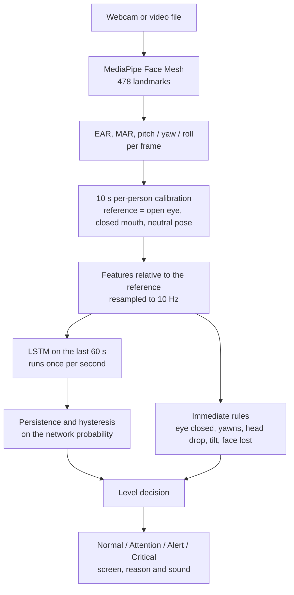

# Real-Time Driver Drowsiness Detection with a Low-Cost Camera

A cascaded drowsiness detector that runs on a CPU with an ordinary webcam: MediaPipe face landmarks, per-person calibration, a 60-second LSTM and immediate rules, merged into four alert levels.


## Overview

Drowsiness at the wheel is a leading cause of road accidents, and most commercial countermeasures depend on dedicated hardware or on vehicle signals such as lane keeping. This project asks how far a plain camera and a CPU can go.

The system reads a video stream (webcam or file), extracts three families of facial measurements per frame and decides, once per second, how drowsy the person looks:

- **Eyes:** Eye Aspect Ratio (EAR), including how long the eyes stay closed and a 60-second PERCLOS (fraction of time with closed eyes).
- **Mouth:** Mouth Aspect Ratio (MAR), used to count yawns.
- **Head:** pitch, yaw and roll from a PnP head-pose fit, used to detect head drops (forward or sideways).

A small LSTM looks at the last 60 seconds to catch slow drowsiness. Rules look at the last few seconds to catch events that cannot wait for a neural network (eyes closed, head falling, face lost after a drop). The result is one of four levels: **Normal, Attention, Alert, Critical**, shown on screen with the reason and with a sound for the higher levels.

All measurements are **relative to the person**, taken from a 10-second calibration at the start, so no absolute EAR or MAR threshold is used.

## How it works



1. **Face Mesh.** MediaPipe Face Mesh (`refine_landmarks=True`, one face) gives the landmarks. Frames are downscaled to 480 px of height before detection for speed.
2. **Measurements.** EAR and MAR are ratios of landmark distances; head pose comes from `solvePnP` on six rigid facial points. A fix for the ambiguous PnP solution (the flipped one, with the face "behind" the camera) is applied in `detection/head_pose.py`.
3. **Calibration.** The first 10 s of valid frames define the reference (open-eye EAR, resting MAR, neutral pose). If there are too few valid frames, calibration restarts. Pressing `r` restarts it at any time and resets all state.
4. **LSTM.** Input: 60 s at 10 Hz, with channels `ear_rel`, `mar_rel`, `pitch_rel`, `yaw_rel`, `roll_rel`, `ear_min_rel` and a `missing` flag. One LSTM layer with 64 units; output is a drowsiness probability, computed once per second.
5. **Immediate rules.** Eyes closed for 2 s or more, pitch drop, lateral tilt with closed eyes, yawn counting and loss of the face after a drop work without waiting for the network.
6. **Levels.** `decide_level` merges the network (after persistence and hysteresis) and the rules; the level only goes down after 2 s, to avoid flicker.

## Alert levels

All values live in `detection/parameters.py`.

| Level | Turns on when | Turns off when |
|---|---|---|
| **Normal** | none of the conditions below | - |
| **Attention** | 3 or more yawns in the last 15 min (`LEVEL_ATTENTION_YAWNS`, `YAWN_COUNT_WINDOW_MIN`; 2 min with `--feira`), **or** network probability > 0.50 for 5 s (`LEVEL_ATTENTION_PROB`, `LEVEL_ATTENTION_PERSIST_S`) | probability below 0.40 (`LEVEL_ATTENTION_PROB_EXIT`) and yawn count below 3 |
| **Alert** | eyes closed (EAR < 75% of the reference) for 2 s or more (`EYE_CLOSED_ALERT_S`), **or** head drop (pitch 18° below neutral for 2 s: `PITCH_DROP_OFFSET_DEG`, `HEAD_DROP_MIN_S`), **or** sideways head tilt (roll more than 25° from the reference, `ROLL_TILT_LIMIT_DEG`) for 2 s with eyes closed, **or** network probability > 0.90 for 10 s (`LEVEL_ALERT_PROB`, `LEVEL_ALERT_PERSIST_S`) | the condition ends; the network alert ends when the probability falls below 0.70 (`LEVEL_ALERT_PROB_EXIT`) |
| **Critical** | head drop with eyes closed for 1 s or more in the 3 s before or during the drop (`CRITICAL_EYE_CLOSED_MIN_S`, `CRITICAL_EYE_LOOKBACK_S`), **or** network Alert together with a head drop, **or** face lost for 1.5 s or more (`FACE_LOST_MIN_S`) after eyes closed for 0.5 s or more in the 3 s before it vanished (or after a drop that had started with eyes closed) | the conditions end |

Notes:

- The level never drops before `LEVEL_HOLD_S` = 2 s of the lower condition.
- Eye-closed tracking for the Critical rule tolerates openings of up to 0.3 s (`BRIDGE_MAX_GAP_S`); the Alert-by-eye rule does not.
- Sound (`sounddevice`): Alert by eye or head beeps every 3 s; Alert by the network alone beeps once on entry and then every 10 s (`SOUND_NET_ALERT_REPEAT_S`); Critical beeps every 1.5 s. `--no-sound` disables it.
- The Attention thresholds (0.50 / 0.40 / 5 s) were set by hand and not tuned on data. Only the Alert persistence was chosen on data (see Results).

## Results

Evaluation on the UTA-RLDD dataset (see [Dataset](#dataset)): **57 participants** (participant 44 excluded), task *alert (0) vs. drowsy (10)*, positive class = drowsy. Splits use the 5 official folds, so **each person appears in only one fold** (never in training and test at once). Each video receives one prediction (the mean over its 60 s windows, taken after the first minute). The LSTM numbers are the mean of **5 random seeds** per fold. Values are percentages, **mean ± standard deviation over the 5 folds**.

### Per video, 10 s calibration

| Model | Accuracy | Precision | Recall | F1 |
|---|---|---|---|---|
| PERCLOS rule with a learned threshold (10 s calibration) | 73.9 ± 13.7 | 72.1 ± 13.2 | 77.4 ± 17.2 | 74.5 ± 14.6 |
| **LSTM (10 s calibration)** | 75.1 ± 6.2 | 79.5 ± 8.7 | 70.6 ± 13.4 | 73.3 ± 7.6 |
| LSTM, optimistic calibration (reference = the person's own alert video) | 84.9 ± 6.8 | 92.0 ± 11.6 | 79.0 ± 15.8 | 83.3 ± 8.3 |

- The **rule** is the video's PERCLOS compared against a threshold learned on the training folds.
- The **optimistic** row uses the person's own alert video as reference. It does not exist in real use and is shown only to quantify what a better reference could bring.
- With a **realistic 10 s calibration**, the LSTM and the PERCLOS rule are **statistically indistinguishable**: the 1.2-point difference in accuracy is far smaller than the 6 to 14-point spread between folds. The LSTM's advantage is a lower variance between folds (6.2 vs. 13.7 in accuracy) and higher precision, not a higher mean.
- Calibration length does not change the picture: with 5 s, 10 s and 60 s the LSTM scores 75.7, 75.1 and 71.7 accuracy, all inside the fold-to-fold noise. We use 10 s because it is cheap for a driver.
- An LSTM vs. GRU comparison at 10 s calibration was a tie (balanced-accuracy difference of 1.7 points, standard error 3.1), so the LSTM was kept.
- The full tables (per window, confusion matrices, all calibration lengths) are generated by `training/parte1.py` into `data/training/` (not versioned).

### False alarms: persistence and hysteresis

On a raw threshold (network > 70% means Alert), alert videos spent a lot of time in Alert. Requiring **probability > 0.90 for 10 s to enter and < 0.70 to leave** (chosen on 51 other participants, `training/persistencia.py`) was tested on 12 videos of 6 held-out participants (04, 08, 13, 25, 37, 50; 600 s each, counted after 70 s):

| | Time in Alert before | Time in Alert after |
|---|---|---|
| Alert (non-drowsy) videos | 9.6% | **0.1%** |
| Drowsy videos | 48.0% | 37.6% |

Drowsy videos lose some Alert time but are still detected; part of what left Alert became Attention. No video reached Critical. Eyes closed for 2 s or more still raises Alert immediately.

## Installation

Requires Python 3.12 (the pinned versions were tested with 3.12). A webcam is needed for the live demo; sound needs a working audio output.

```bash
git clone https://github.com/Pires013/driver-drowsiness-detection.git
cd driver-drowsiness-detection
python -m venv .venv
.venv\Scripts\activate            # Linux/macOS: source .venv/bin/activate
pip install -r requirements.txt --extra-index-url https://download.pytorch.org/whl/cpu
```

PyTorch is installed in its CPU-only build. The project was developed on Windows; the collection script `collection/master_collection.py` uses `winsound` and is Windows-only.

## Usage

Run every command from the repository root, in module mode.

### Live demo

```bash
python -m demos.main_demo                   # webcam; 10 s calibration, then levels
python -m demos.main_demo --feira           # yawns counted over the last 2 min instead of 15 (booth / demo mode)
python -m demos.main_demo --debug           # starts with the debug panel on
python -m demos.main_demo --video clip.mp4  # a video file instead of the webcam
python -m demos.main_demo --no-sound        # no beeps
python -m demos.main_demo --video clip.mp4 --headless --timeline timeline.csv --shots shots_dir
```

Keys: **`r`** recalibrates and resets everything, **`d`** toggles the debug panel, **`q`** (or Esc) quits. The screen shows the level, the reason for the level, the network probability (last 60 s), PERCLOS, yawn count and head-drop state.

**The trained model is not in the repository** (`data/` is ignored by git). For the demo to run, these two files must exist:

```
data/training/modelo_final/config_modelo_final.json
data/training/modelo_final/lstm_final_cal10.pt
```

Either train them (`python -m training.parte1 final`, see below, which needs the UTA-RLDD features) or copy them from a machine that already has them. `--config` points to another JSON; `--checkpoint` to another `.pt`. Nothing else outside the repository is needed: MediaPipe's Face Mesh model ships inside the `mediapipe` pip package.

### Validation recording

Record yourself and press **one key per action performed** (`b` yawn, `h` head drop, `c` looking at the phone, `p` looking at the dashboard or mirror, `n` normal), then compare the marks with what the detectors found:

```bash
python -m collection.validation_recording                      # webcam; saves to data/own/<session>
python -m collection.validate_events data/own/<session>        # precision, recall, false alarms per event type
python -m collection.validate_events data/own/<session> --calibration-start 12
```

`validate_events` also counts false head drops during phone and dashboard glances, and how many Critical alerts the rules alone (without the network) would raise.

### Feature extraction and training

```bash
python -m pipeline.extract_features                  # UTA-RLDD videos in data/uta-rldd -> data/features/ (one CSV per video)
python -m pipeline.sanity_check                      # per-video sanity statistics and plots (data/sanity_check/)
python -m training.prepare_data 5                    # windows for cycle 5 (10 s calibration)
python -m training.run_experiments --cycle 5         # rule and network experiments, 5 folds
python -m training.parte1 tabelas                    # calibration-length tables (data/training/relatorio_parte1.md)
python -m training.parte1 final                      # final LSTM (10 s calibration) + model JSON
```

`training.parte1 tabelas` expects cycles 4, 5 and 6 (5, 10 and 60 s calibration) to have been prepared and run first (`prepare_data N` followed by `run_experiments --cycle N` for each).

## Repository structure

```
.
├── detection/      shared library: landmarks, EAR, MAR, head pose, calibration, preprocessing,
│                   event detectors and level logic (events.py), all constants in parameters.py
├── demos/          main_demo.py (live system) and small demos of each measurement
│                   (ear_webcam, mar_webcam, head_pose_webcam, face_mesh_basic)
├── collection/     validation recording (one key per action) and validate_events;
│                   master_collection for labeled own-data blocks
├── pipeline/       UTA-RLDD processing: extract_features, sanity_check, sanity_plots, inspect_frames
├── training/       window preparation, rule and RNN experiments (LSTM/GRU), calibration-length study,
│                   persistence and hysteresis search, report generation
├── requirements.txt
└── data/           NOT in the repository (ignored): videos, features, recordings, models, reports
```

## Dataset

This work uses **UTA-RLDD** (University of Texas at Arlington Real-Life Drowsiness Dataset). **The dataset is not included in this repository.** Request it from the authors and place the videos under `data/uta-rldd/<FoldN_partM>/<participant>/<label>.<ext>`, where the label in the file name is 0 (alert), 5 (low vigilance) or 10 (drowsy). The label is **self-reported** by each participant.

> Ghoddoosian, R., Galib, M., and Athitsos, V. "A Realistic Dataset and Baseline Temporal Model for Early Drowsiness Detection." *Proceedings of the IEEE/CVF Conference on Computer Vision and Pattern Recognition Workshops (CVPRW)*, 2019.

Dataset page: <https://sites.google.com/view/utarldd/home>

The videos show participants' faces. **Participant data (videos, frames, extracted features and personal recordings) is never versioned**: `data/` and `collection/sessions/` are in `.gitignore`, and the repository contains code only.

## Limitations

- **Self-reported labels.** Drowsiness labels in UTA-RLDD come from the participants, not from an objective measure.
- **Results are close to the simple rule.** With a realistic calibration, the difference between the LSTM and a PERCLOS rule is inside the noise between folds (see Results). The network does not beat the rule in the mean.
- **Single calibration.** The reference is taken once, in the first 10 s; it does not adapt to changes in posture, lighting or camera position afterwards.
- **Reflections on glasses, sunglasses and low light** degrade the landmarks and the eye measurements; none of these conditions was evaluated separately.
- **Head pose.** The pose comes from a generic 3D face model; with the head near profile, `solvePnP` can return wrong angles, and such frames are marked invalid.
- **Lateral-tilt rule and Critical rules** were checked with synthetic cases and a short own recording, not on a systematic test with many people.
- **Short own validation.** The validation recording is small and from a single person.

## Roadmap

- Adaptive calibration that updates the reference during use.
- A low-cost infrared camera for night driving and glasses.
- Embedded hardware (a single-board computer in the vehicle).
- A separate **distraction** level (looking at the phone, dashboard or mirror), kept apart from drowsiness.

## Acknowledgements

- The authors of **UTA-RLDD** for the dataset.
- **MediaPipe** (Google) for the Face Mesh landmarks: Kartynnik et al., "Real-time Facial Surface Geometry from Monocular Video on Mobile GPUs", 2019; and Lugaresi et al., "MediaPipe: A Framework for Building Perception Pipelines", 2019.
- OpenCV, PyTorch, NumPy, pandas and scikit-learn.

## Author

**Matheus Pires Correa Pinto**

## License

Released under the [MIT License](LICENSE). The UTA-RLDD dataset has its own terms and is not covered by this license.
